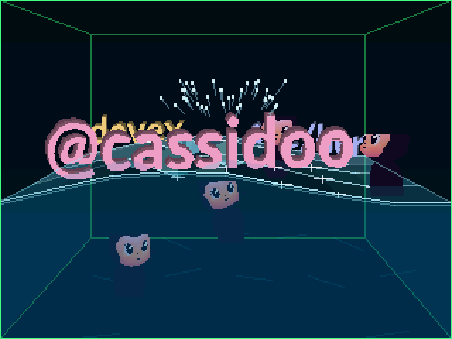
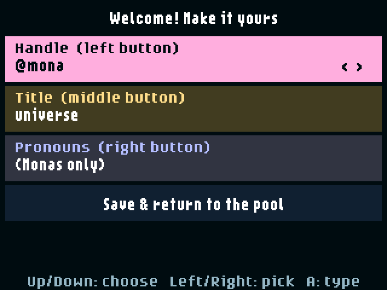
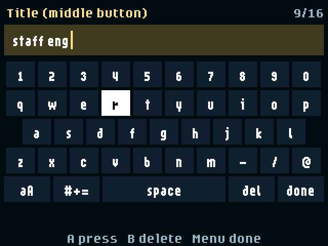

# Splashy Badge 💧

A motion-reactive 3D water tank for the **GitHub Universe 2026 badge**. Tilt the
badge to slosh the water, then drop your handle, title, and pronouns in as
floating 3D letters (and lots of little Monas).



| First launch | On-badge keyboard | Icon |
| --- | --- | --- |
|  |  |  |

## Install

You need a GitHub Universe 2026 badge with the October 2026 (or later)
firmware, a USB-C **data** cable, and Python 3.8+.

```sh
git clone https://github.com/cassidoo/splashy-badge
cd splashy-badge
python3 -m pip install --user mpremote
python3 install.py
```

The installer finds the badge (USB `2e8a:1101`), switches it to mass-storage
mode, copies only `apps/splashy_badge`, ejects the drive, checks every file
over serial, and resets the badge. Allow about two minutes. It never changes
other apps, `secrets.py`, or saved state. If Splashy Badge is already
installed, the old copy is backed up into `backups/` first.

- More than one badge connected? Add `--port <port>` (see `mpremote devs`).
- If the drive doesn't appear by itself, open the badge's **Mass Storage** app
  and run `python3 install.py --volume <path to BADGER>`.
- Tested on macOS; Linux and Windows are supported on a best-effort basis. See
  [AGENTS.md](AGENTS.md) for troubleshooting and a manual copy fallback.

Using a coding agent? Point it at this repo and ask it to "install Splashy Badge
onto my badge". [AGENTS.md](AGENTS.md) has the steps.

## Play

Open **Splashy Badge** from the badge menu. The first time, setup opens so you
can make it yours: your handle starts as the badge's `GITHUB_USERNAME`.

| Control | Action |
| --- | --- |
| Tilt the badge | Slosh the water and shift the tank's perspective |
| Right-side Up / Down | Raise / lower the water |
| Bottom Left / Right / Select | Drop your handle / title / pronouns. Each word drops once; after that, the button drops a Mona |
| Touch D-pad | Blow wind |
| Touch A | Clear the pool |
| Touch B | Change the tank edge color |
| Touch Menu | Open setup |
| Home | Back to the badge menu |

In setup, Up / Down choose a line, Left / Right cycle presets, and A opens an
on-screen keyboard (B deletes, Menu finishes typing). Pick **Save & return**, or
press B or Menu, to save and go back to the pool. Leave a label blank to have
that button drop only Monas. Labels are saved on the badge with
`badgeware.State`, so they survive restarts.

See [the app README](splashy_badge/README.md) for more about how it looks and
behaves.

## Develop

```sh
python3 -m unittest discover -s tests
python3 tools/build_icon.py          # regenerate splashy_badge/icon.png
python3 tools/capture_smoke.py PORT  # run on a badge from this checkout; writes preview.png
```

`splashy_badge/icon.png` is a 24x24 water droplet. The October 2026 menu only
draws its own built-in icons, so for now Splashy Badge shows the default tile.

`physics.py` contains the spring-coupled wave grid and buoyancy. Waves take at
most two stable 0.05 s sub-steps per frame and objects step once, so slow
frames never snowball into extra physics work. Heavy objects plunge, rebound on
a soft buoyancy spring, wobble towards the local wave slope, and push the water
as they bob. Hot loops use `@micropython.native`.
`shading.py` computes integer water shading, crests, and glints; on the badge
it is replaced by the `@micropython.viper` kernel in `water_kernel.py` (about
27x faster), with the pure-Python version as a fallback. Equal-shade water
cells are merged into strips and each shade is filled as one multi-contour shape.
`controls.py` maps the two separate firmware input sources.
`render.py` draws a screen-corner-anchored perspective tank, translucent glossy
water, rings, and spray at 320x240. Surface rows are painted back to front with
objects slotted in by depth, so nearer water tints only submerged parts.
`lettering.py` reads outlines from the badge's
`/system/assets/fonts/lato-900.af` (falling back to built-in low-poly glyphs)
and orients contours so extruded walls face outwards. Each word's outline is
built once as a vector shape; per frame it is drawn as a stack of layers, each
placed by a rotate-scale-rotate `mat3` equivalent to its 3D rotation, so no
per-vertex Python runs while words move.
`nametag.py` is the Menu setup screen: presets, an on-screen keyboard modelled
on the Settings app, and label persistence through `badgeware.State`. Changing
a label rebuilds only that word's mesh and removes its old copy from the pool.
`floaty_mona.py` loads the home screen's `/system/apps/menu/mona_menu.p3d`
read-only and draws it with `pico3d`; its camera uses a clip-space shift so its
off-axis perspective matches the tank exactly. Each Mona is cached as a 40x44
sprite: a stale one is rendered onto a magenta-keyed patch of the screen before
the frame is painted, then a viper routine (`sprite_kernel.py`) copies it into
her RGBA sprite, which is faster than rendering to an off-screen image. Other
frames just blit it. If pico3d or the model is
unavailable, Mona falls back to a flat silhouette.
Submerged box edges and floor light patterns remain visible through alpha
compositing. There are no persistent HUD labels.
The app uses `badge.imu()` rather than raw I2C or GPIO.
The motion filter treats sensor readings as relative raw units rather than
assuming a firmware-specific gyro scale. Leaving setup (or flipping the badge over) recalibrates the neutral pose.

## License

[MIT](LICENSE)
